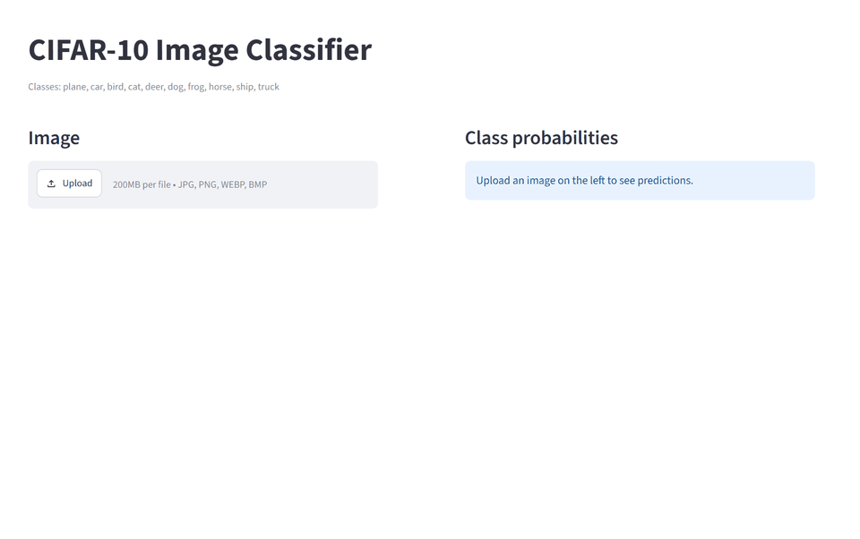
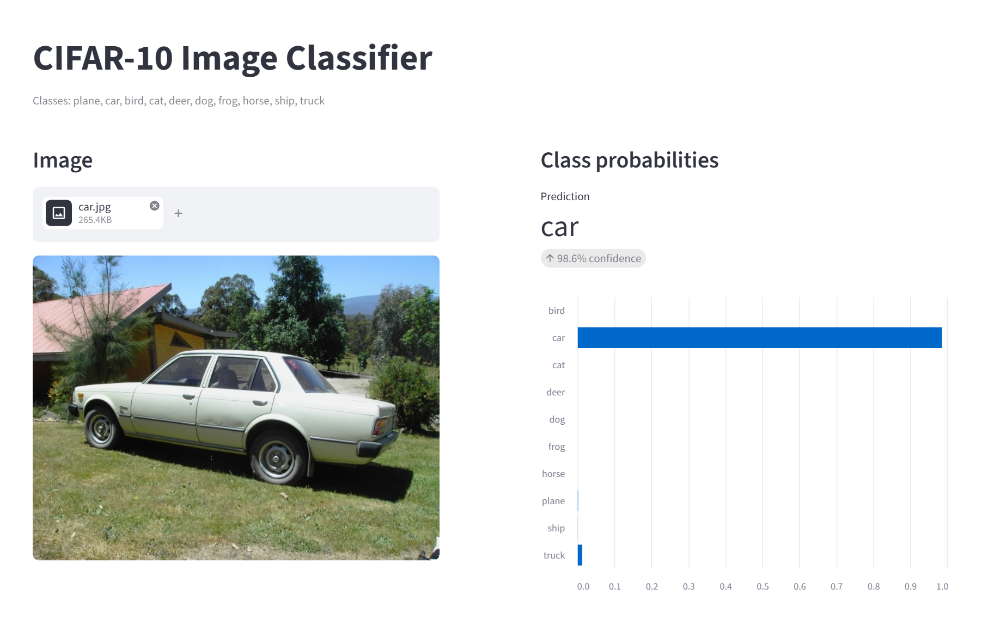
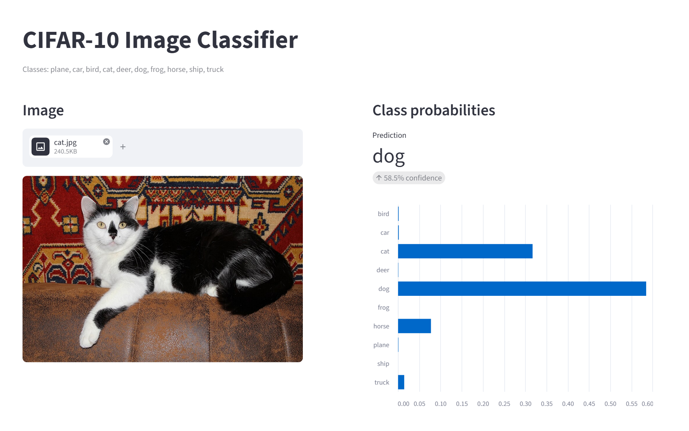
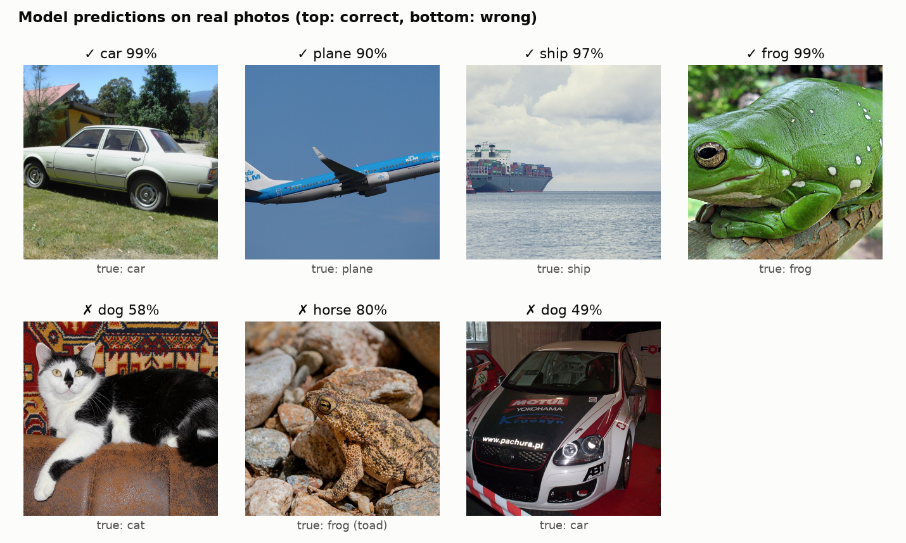
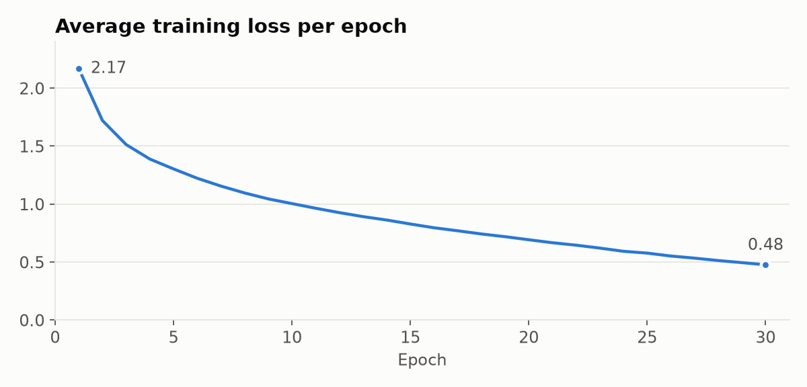
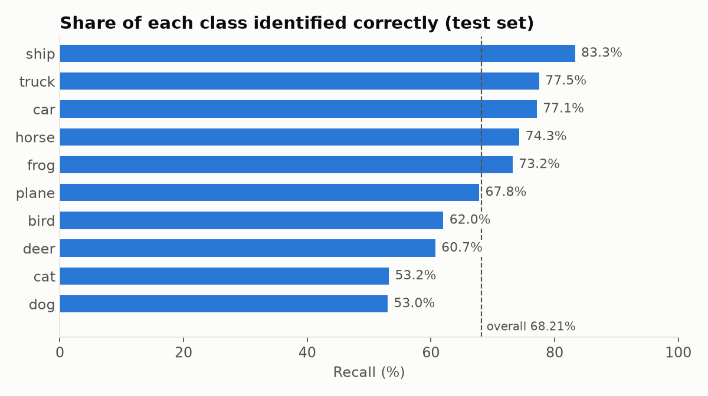
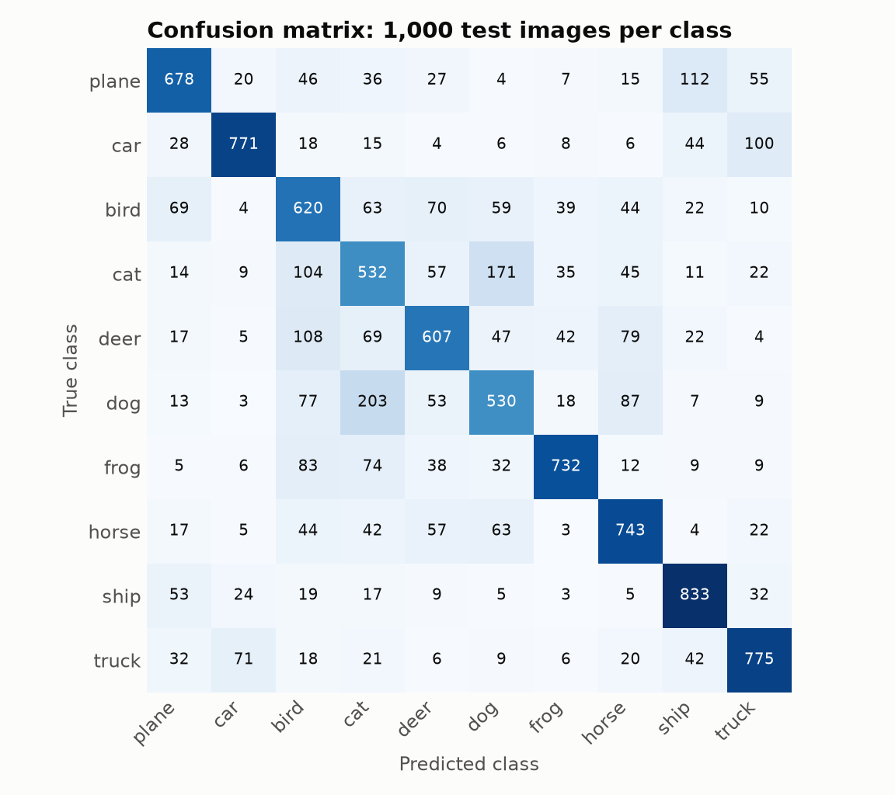
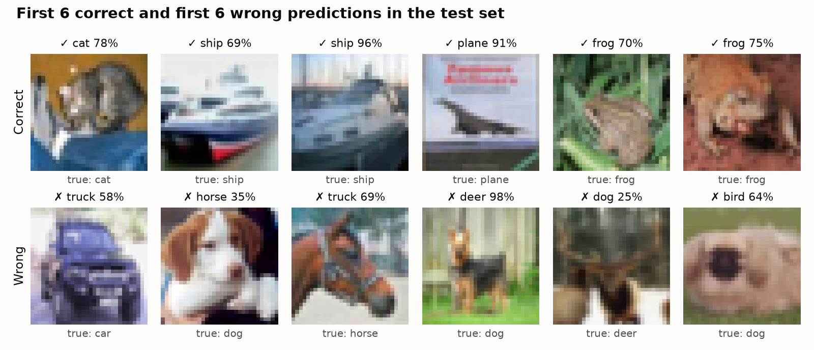
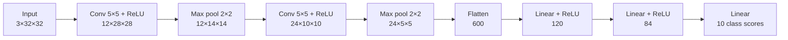

# CIFAR-10 Image Classifier

A small convolutional neural network, built from scratch in PyTorch, that sorts 32×32 colour images into 10 categories. It reaches **68.21% accuracy** on the 10,000-image CIFAR-10 test set, against a 10% baseline for random guessing, using about 91,000 parameters.

**[Try the live demo](https://sidhantcifar10.streamlit.app/)**: upload an image and see the model's prediction and the probability for each class.


> [!NOTE]
> **For recruiters and reviewers: this model is not very accurate, and that's expected.**
> I built this project to learn how a CNN works end to end, from loading data to training, evaluating and deploying a model. I didn't set out to build the most accurate classifier I could.
> - **It gets about 1 in 3 test images wrong.** Modern models score above 99% on CIFAR-10, but they are much larger and are usually pretrained on millions of extra images.
> - **It's sometimes confidently wrong.** Of the 3,179 test images it got wrong, 458 were predicted with more than 90% confidence, so a high confidence score doesn't guarantee a correct answer.
> - **Your own photos may do worse than the test set.** The app shrinks every upload to 32×32 pixels, and real photos often look different from CIFAR-10 images. See the [real-photo examples](#real-photos).
>
> The [Limitations](#limitations) and [Possible next steps](#possible-next-steps) sections explain why it falls short and how I would improve it.

## Demo



The deployed app with three real photos: it gets the car and the plane right, and mistakes the cat for a dog.

| Correct: a car | Wrong: a cat predicted as a dog |
|---|---|
|  |  |

The cat shows the model's most common mistake. It gives "dog" 58.5% and "cat" about 32%, so it does consider the right answer, but it ranks it second.

### Real photos



The model was trained only on CIFAR-10, so these show how it handles photos it was never designed for. I chose them to show both strengths and weaknesses, so the 4-out-of-7 score here is **not** an accuracy measurement.

- **What works:** clear side views of the subject against a simple background, similar to how CIFAR-10 images are framed.
- **What fails:**
  - **Cat:** the model has trouble telling cats and dogs apart, which matches the test-set results.
  - **Toad:** its colour blends into the rocks, which probably makes the shape hard to pick out at 32×32.
  - **Car from the front:** the busy stickers and the unusual angle are likely causes.

  I haven't tested these explanations for the toad and the car.

The grid shows a square crop of each photo, while the model sees the whole image resized to 32×32.

## Results

All numbers below come from the committed `trained_net.pth`.

| Metric | Value |
|---|---|
| Test accuracy | **68.21%** (10,000 images) |
| Training accuracy | 85.56% (50,000 images) |
| Final training loss | 0.4760 |
| Average confidence when correct | 85.2% |
| Average confidence when wrong | 64.4% |
| Parameters | 91,270 |
| Model file size | 369 KB |

### Training loss



The loss is still falling at epoch 30, but test accuracy doesn't keep up with it (see overfitting below).

### Per-class performance



Each class has 1,000 test images. Recall is the share of that class the model found. Precision is the share of its predictions for that class that were correct.

| Class | Recall | Precision |
|---|---:|---:|
| Plane | 67.8% | 73.2% |
| Car | 77.1% | 84.0% |
| Bird | 62.0% | 54.5% |
| Cat | 53.2% | 49.6% |
| Deer | 60.7% | 65.4% |
| Dog | 53.0% | 57.2% |
| Frog | 73.2% | 82.0% |
| Horse | 74.3% | 70.4% |
| Ship | 83.3% | 75.3% |
| Truck | 77.5% | 74.7% |

### Confusion matrix



Each row is the true class and each column is the predicted class. The diagonal shows correct predictions.

### Sample predictions



These are the first six correct and first six wrong predictions in the test set, in their original order, with no hand-picking.

### What the results show

- **Vehicles are easier than animals.** Ships, trucks and cars have the highest recall, while cats and dogs have the lowest.
- **Cats and dogs get mixed up most.** Of the 1,000 dog images, 203 were predicted as cats, and 171 of the 1,000 cat images were predicted as dogs.
- **Backgrounds may be misleading the model.** 112 planes were predicted as ships and 108 deer as birds. Shared backgrounds, such as blue sky and water, are a possible cause, but this hasn't been tested.
- **The model is overfitting.** The 17-point gap between training and test accuracy shows that it learned details of the training images that don't carry over to new ones.

## Architecture



The convolutional layers detect visual patterns, and the linear layers turn them into one score per class. The class with the highest score is the prediction, and the app converts the scores to probabilities with softmax.

## Quick start

### 1. Install

```bash
git clone https://github.com/sidhantds/cifar10-image-classifier.git
cd cifar10-image-classifier

python -m venv .venv
source .venv/bin/activate        # Windows: .venv\Scripts\activate

pip install -r requirements.txt
```

The project was run on Python 3.14. `requirements.txt` installs the CPU-only version of PyTorch, which is all the app needs.

### 2. Run the app locally

```bash
streamlit run app.py
```

This opens the same app as the [live demo](https://sidhantcifar10.streamlit.app/) at `http://localhost:8501`.

### 3. Classify images in the notebook

1. Put your images in `test_images/`.
2. Open `ImageClassifierCNN.ipynb` in VS Code with the Jupyter extension and select the `.venv` environment. If you prefer the browser, run `pip install notebook` and then `jupyter notebook`.
3. Run every cell from top to bottom, **skipping the training cell** (`for epoch in range (30):`) and the `torch.save` cell.

The first run downloads CIFAR-10 from Hugging Face. The last cell then prints one prediction per image:

```text
test_images/your_image.jpg -> Prediction: horse
```

Images work best when they show a single, clear subject from one of the 10 classes: plane, car, bird, cat, deer, dog, frog, horse, ship or truck.

### 4. Retrain the model

Run every cell in order, including the training and `torch.save` cells. This overwrites `trained_net.pth`. The notebook runs on the CPU and sets no random seed, so your exact numbers will differ.

## Training setup

| Setting | Value |
|---|---|
| Dataset | [CIFAR-10](https://huggingface.co/datasets/uoft-cs/cifar10): 50,000 training and 10,000 test images |
| Preprocessing | Each RGB channel normalized to the range −1 to 1 |
| Data augmentation | None |
| Loss | Cross-entropy |
| Optimizer | SGD with momentum 0.9 and learning rate 0.001 |
| Batch size | 32 |
| Epochs | 30 |

## Design decisions

- **Hugging Face for the dataset:** the original CIFAR-10 host was estimating more than an hour to download over a slow connection, while the Hugging Face copy loaded in under 20 seconds.
- **`num_workers=0`:** on Windows, worker processes can't load a `Dataset` class defined inside a notebook, so data loads in the main process. This is slower but works everywhere.
- **Trained weights in the repo:** at 369 KB, they're small enough to commit, so nobody has to retrain just to try the model.
- **CPU-only PyTorch for deployment:** the CPU build is a much smaller install than the GPU build, and a model this small doesn't need a GPU to make predictions.

## Limitations

- **Moderate accuracy:** 68.21% means roughly one wrong answer in every three images.
- **Overconfident mistakes:** 458 wrong test predictions had more than 90% confidence, so the confidence score shouldn't be read as a guarantee.
- **Fixed categories:** every image gets one of the 10 labels, even if it shows something else, such as a person.
- **Low resolution:** images are resized to 32×32 pixels, so small subjects and fine details are lost.
- **Test images may not match real photos:** the accuracy above applies to CIFAR-10, and may be lower on your own photos.
- **No validation set:** nothing was held back from training apart from the test set, so the 68.21% comes from a single training run.
- **Not reproducible to the digit:** with no random seed, retraining gives slightly different results.

## Possible next steps

- Add data augmentation, such as random crops and horizontal flips, to reduce overfitting.
- Add batch normalization and dropout.
- Hold out a validation set for choosing settings and stopping training early.
- Try a deeper network or a pretrained model, such as a fine-tuned ResNet.
- Set a random seed so that results can be reproduced and compared.
- Move the code into scripts with a command-line interface for predictions.

## Project structure

```text
.
├── ImageClassifierCNN.ipynb   # Data loading, model, training, evaluation, prediction
├── app.py                     # Streamlit web app
├── trained_net.pth            # Trained model weights
├── assets/                    # Screenshots and result charts used in this README
├── test_images/               # Put your own images here (contents ignored by Git)
├── requirements.txt           # Pinned dependencies
└── README.md
```

## Acknowledgements

The CIFAR-10 dataset comes from Alex Krizhevsky, [*Learning Multiple Layers of Features from Tiny Images*](https://www.cs.toronto.edu/~kriz/learning-features-2009-TR.pdf), 2009.

The real photos come from Wikimedia Commons and are in the public domain or released under CC0:

| Photo | Author | Licence |
|---|---|---|
| [Car (Toyota Corona)](https://commons.wikimedia.org/wiki/File:1980_Toyota_Corona_(XT130)_CS_sedan_(2006-11-26)_03.jpg) | Daniel Cleaveley | Public domain |
| [Plane (KLM Boeing 737)](https://commons.wikimedia.org/wiki/File:Boeing_737-800_PH-BCA_KLM_takeoff_at_Schiphol.JPG) | Alf van Beem | Public domain |
| [Container ship](https://commons.wikimedia.org/wiki/File:Container_ship_in_Koper_2013.jpg) | Martin Dörsch | CC0 |
| [Green tree frog](https://commons.wikimedia.org/wiki/File:Australia_green_tree_frog_(Litoria_caerulea)_crop.jpg) | LiquidGhoul | Public domain |
| [Cat](https://commons.wikimedia.org/wiki/File:Domestic_cat_2011_G02.jpg) | George Chernilevsky | Public domain |
| [Cane toad](https://commons.wikimedia.org/wiki/File:Bufo_marinus_in_Venezuela.jpg) | Wilfredor | CC0 |
| [Car front (Volkswagen Golf)](https://commons.wikimedia.org/wiki/File:Volkswagen_Golf_Pachura_front_Poznan_2011.jpg) | Peżot | CC0 |

## License

No license has been added yet, so default copyright applies.
