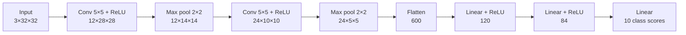

# CIFAR-10 Image Classifier

A small convolutional neural network, built from scratch in PyTorch, that sorts 32×32 colour images into 10 categories. It reaches **68.21% accuracy** on the 10,000-image CIFAR-10 test set, against a 10% baseline for random guessing, using about 91,000 parameters.

A trained model is included, so you can classify your own images without retraining.


## Results

| Metric | Value |
|---|---|
| Test accuracy | **68.21%** (10,000 images) |
| Training accuracy | 85.56% (50,000 images) |
| Final training loss | 0.4760 |
| Parameters | 91,270 |
| Model file size | 369 KB |

### Per-class performance

Each class has 1,000 test images. Recall is the share of that class the model found. Precision is the share of its predictions for that class that were correct.

| Class | Recall | Precision |
|---|---:|---:|
| Plane | 67.8% | 73.2% |
| Car | 77.1% | 84.0% |
| Bird | 62.0% | 54.5% |
| Cat | 53.2% | 49.6% |
| Deer | 60.7% | 65.4% |
| Dog | 53.0% | 57.2% |
| Frog | 73.2% | 82.0% |
| Horse | 74.3% | 70.4% |
| Ship | 83.3% | 75.3% |
| Truck | 77.5% | 74.7% |

### What the results show

- **Vehicles are easier than animals.** Ships, trucks, and cars have the highest recall, while cats and dogs have the lowest.
- **Cats and dogs get mixed up most.** Of the 1,000 dog images, 203 were predicted as cats, and 171 of the 1,000 cat images were predicted as dogs.
- **Backgrounds may be misleading the model.** 112 planes were predicted as ships and 108 deer as birds. Shared backgrounds, such as blue sky and water, are a possible cause, but this hasn't been tested.
- **The model is overfitting.** The 17-point gap between training and test accuracy shows that it learned details of the training images that don't carry over to new ones.

## Architecture



The convolutional layers detect visual patterns, and the linear layers turn them into one score per class. The class with the highest score is the prediction.

## Quick start

### 1. Install

```bash
git clone https://github.com/sidhantds/cifar10-image-classifier.git
cd cifar10-image-classifier

python -m venv .venv
source .venv/bin/activate        # Windows: .venv\Scripts\activate

pip install -r requirements.txt
```

The project was run on Python 3.14. Open `ImageClassifierCNN.ipynb` in VS Code with the Jupyter extension and select the `.venv` environment. If you prefer the browser, run `pip install notebook` and then `jupyter notebook`.

### 2. Classify your own images

1. Put your images in `test_images/`.
2. Run every cell from top to bottom, **skipping the training cell** (`for epoch in range (30):`) and the `torch.save` cell.

The first run downloads CIFAR-10 from Hugging Face. The last cell then prints one prediction per image:

```text
test_images/your_image.jpg -> Prediction: horse
```

Images work best when they show a single, clear subject from one of the 10 classes: plane, car, bird, cat, deer, dog, frog, horse, ship, or truck.

### 3. Retrain the model

Run every cell in order, including the training and `torch.save` cells. This overwrites `trained_net.pth`. The notebook runs on the CPU and sets no random seed, so your exact numbers will differ.

## Training setup

| Setting | Value |
|---|---|
| Dataset | [CIFAR-10](https://huggingface.co/datasets/uoft-cs/cifar10): 50,000 training and 10,000 test images |
| Preprocessing | Each RGB channel normalized to the range −1 to 1 |
| Data augmentation | None |
| Loss | Cross-entropy |
| Optimizer | SGD with momentum 0.9 and learning rate 0.001 |
| Batch size | 32 |
| Epochs | 30 |

## Design decisions

- **Hugging Face for the dataset:** the original CIFAR-10 host was estimating more than an hour to download over a slow connection, while the Hugging Face copy loaded in under 20 seconds.
- **`num_workers=0`:** on Windows, worker processes can't load a `Dataset` class defined inside a notebook, so data loads in the main process. This is slower but works everywhere.
- **Trained weights in the repo:** at 369 KB, they're small enough to commit, so nobody has to retrain just to try the model.

## Limitations

- **Fixed categories:** every image gets one of the 10 labels, even if it shows something else, such as a person.
- **Low resolution:** images are resized to 32×32 pixels, so small subjects and fine details are lost.
- **Test images may not match real photos:** the accuracy above applies to CIFAR-10, and may differ on your own photos.
- **No validation set:** nothing was held back from training apart from the test set, so the 68.21% comes from a single training run.
- **Not reproducible to the digit:** with no random seed, retraining gives slightly different results.

## Possible next steps

- Add data augmentation, such as random crops and horizontal flips, to reduce overfitting.
- Add batch normalization and dropout.
- Hold out a validation set for choosing settings and stopping training early.
- Try a deeper network or a pretrained model.
- Add a confusion matrix and a seed so that results can be reproduced and compared.
- Move the code into scripts with a command-line interface for predictions.

## Project structure

```text
.
├── ImageClassifierCNN.ipynb   # Data loading, model, training, evaluation, prediction
├── trained_net.pth            # Trained model weights
├── test_images/               # Put your own images here (contents ignored by Git)
├── requirements.txt           # Pinned dependencies
└── README.md
```

## Acknowledgements

The CIFAR-10 dataset comes from Alex Krizhevsky, [*Learning Multiple Layers of Features from Tiny Images*](https://www.cs.toronto.edu/~kriz/learning-features-2009-TR.pdf), 2009.

## License

No license has been added yet, so default copyright applies.
